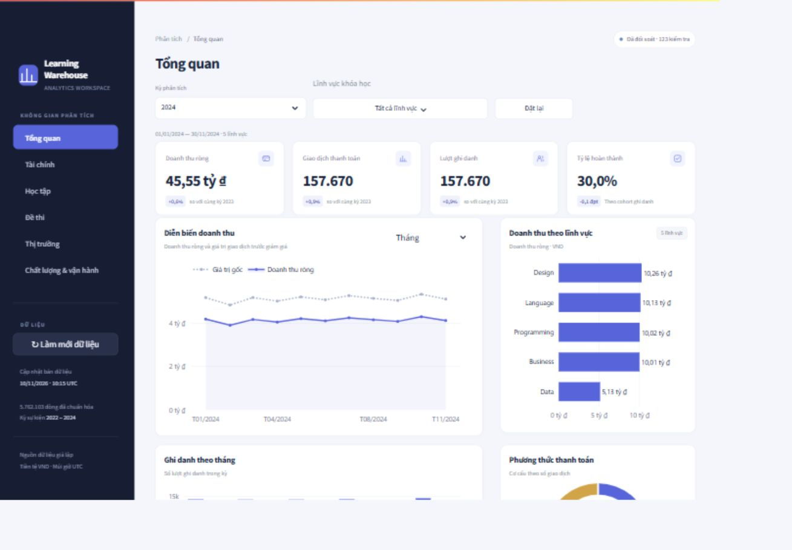
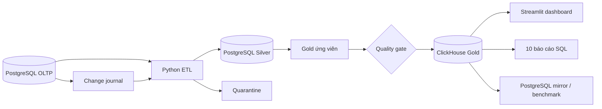
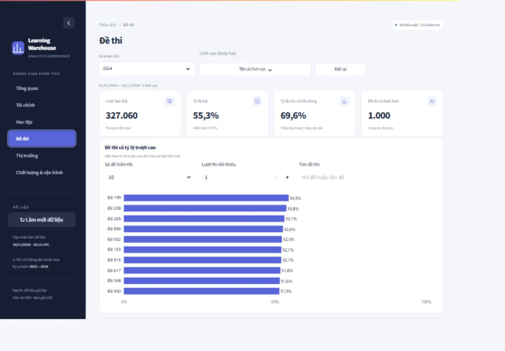

# Online Learning Warehouse

Kho dữ liệu học trực tuyến sử dụng PostgreSQL, Python và ClickHouse. Dự án mô phỏng luồng từ giao dịch nguồn đến mô hình sao, kiểm tra chất lượng, báo cáo SQL và dashboard tương tác.

Dữ liệu được sinh bằng Faker/NumPy, trải trong giai đoạn 2022–2024. Đây là dự án học tập chạy cục bộ bằng Docker, không sử dụng dữ liệu học viên thật.



## Dự án giải quyết gì?

Hệ thống trả lời các câu hỏi về doanh thu, giảm giá và hoàn tiền, ghi danh và hoàn thành khóa học, kết quả quiz, hiệu quả giảng viên và địa lý học viên tại thời điểm giao dịch.

Gold gồm 4 fact và 7 dimension. Lịch sử học viên dùng SCD Type 2; ngày ghi danh và ngày hoàn thành dùng chung dimension ngày. Các báo cáo kết hợp nhiều fact bằng cách tổng hợp về cùng grain trước khi join.



## Chạy dự án

Yêu cầu Docker Desktop với Linux containers và Docker Compose. Chạy lệnh từ thư mục gốc repository.

```bash
docker compose up -d --wait postgres clickhouse
docker compose build runner dashboard
docker compose run --rm runner python cli.py all
docker compose --profile demo up -d --wait dashboard
```

Dashboard mở tại [localhost:8501](http://localhost:8501). Lệnh `all` khởi tạo schema và role, sinh dữ liệu khi nguồn còn trống, chạy full ETL, xuất báo cáo và benchmark. Mặc định có 500.000 lượt ghi danh và hơn 5 triệu dòng nguồn. Lần đầu cần vài phút, tùy cấu hình máy.

Sao chép `.env.example` thành `.env` nếu cần đổi cổng hoặc thông tin đăng nhập trước khi tạo volume. Mật khẩu mặc định chỉ dùng cho demo localhost. Không commit `.env`.

## Nạp tăng dần

```bash
docker compose run --rm runner python -m demo.seed_incremental
docker compose run --rm runner python cli.py pipeline --mode incremental
docker compose run --rm runner python cli.py doctor
```

Journal ghi insert, update và delete trong cùng giao dịch nguồn. ETL dùng snapshot, checkpoint theo transaction ID và revision từng khóa để xử lý commit muộn và tránh replay phiên bản cũ. Dòng không hợp lệ được cách ly; cập nhật sai giữ lại phiên bản sạch trước đó.

Gold được dựng và kiểm tra trước khi công bố. Kế hoạch UUID từng bảng được lưu trong PostgreSQL để phục hồi nếu tiến trình dừng giữa lúc đổi bảng. Checkpoint chỉ được xác nhận cùng manifest thành công.

## Dashboard

Sáu trang gồm tổng quan, tài chính, học tập, đề thi, thị trường, chất lượng và vận hành. Có bộ lọc năm/ngày/lĩnh vực, so sánh cùng kỳ, biểu đồ phân rã doanh thu, tìm kiếm đề thi và xuất CSV.

Năm mới nhất hiển thị đến ngày ghi danh cuối cùng có trong nguồn. Chọn Toàn kỳ hoặc Tùy chọn để xem các sự kiện học tập sau ngày đó. Tỷ lệ hoàn thành được tính theo cohort ghi danh tại bản dữ liệu hiện tại.



## Kiểm thử và kết quả

```bash
docker compose run --rm runner python -m unittest discover -s tests -v
docker compose run --rm dashboard python -m tests.dashboard_check
```

Trên Windows, `scripts/verify.ps1` tạo project Docker riêng và chạy smoke test từ volume trống, gồm 5.000 ghi danh, ETL, báo cáo, benchmark và các tình huống lỗi.

Kết quả ghi nhận ngày 10/11/2026 trên dữ liệu giả lập cục bộ:

| Hạng mục | Kết quả |
|---|---|
| Dữ liệu sau các lần thêm sự kiện thử nghiệm | 5.762.103 dòng nguồn |
| Quality gate | 123 kiểm tra đạt |
| Unit/integration | 12 test đạt |
| Dashboard | 13 kiểm tra đạt, có đối soát độc lập với Silver |
| Hồi quy trên môi trường riêng | 15 kiểm tra đạt, gồm late commit, delete và phục hồi sau crash |
| Benchmark | Toàn bộ dòng 11 bảng và kết quả 7 truy vấn khớp giữa hai engine |
| Full / incremental 10.000 dòng / lần rỗng | 205,439 s / 12,543 s / 0,806 s |

Các số đo trên là kết quả cục bộ đã lưu, không phải cam kết hiệu năng. Xem [bằng chứng kiểm tra](docs/verification/) và [benchmark](docs/verification/benchmark.md). GitHub Actions chạy smoke test nhỏ; kết quả CI được theo dõi riêng với các số đo này.

## Cấu trúc repository

```text
oltp/         Schema nguồn và generator
etl/          Extract, validate, staging, publication và recovery
dw/ddl/       DDL và mapping SQL sang Gold
analytics/    10 báo cáo và bộ xuất CSV
benchmark/    SQL đối chiếu và đo hai engine
demo/         Dashboard và truy vấn phục vụ giao diện
tests/        Unit, integration và regression scenarios
docker/       Cấu hình PostgreSQL và ClickHouse
docs/         Kiến trúc, mapping, dictionary, runbook và bằng chứng
scripts/      Kiểm tra mã và smoke test độc lập
```

Artifacts runtime được tạo trong `artifacts/`, không đưa vào Git. Repository không chứa database volume, cache, file ZIP lồng nhau hoặc bộ dữ liệu hàng triệu dòng; generator tạo lại dữ liệu khi chạy.

## Tài liệu

- [Kiến trúc và cơ chế phục hồi](docs/architecture.md)
- [Source-to-target mapping](docs/mapping.md)
- [Data dictionary](docs/data_dictionary.md)
- [Runbook](docs/runbook.md)

## Giới hạn

Kỳ ngày cố định 2022–2024; sự kiện Gold có độ chính xác giây. Journal chưa tự động retention và giao dịch nguồn mở lâu có thể trì hoãn nạp. Công bố chỉ nguyên tử từng bảng; consumer trong dự án dùng khóa đọc, SQL client ngoài dự án cần tránh cửa sổ công bố. Portal chưa có xác thực. Chưa nghiệm thu tải production hoặc phục hồi backup. Mục tiêu incremental có dữ liệu trong 1–2 giây chưa đạt.
