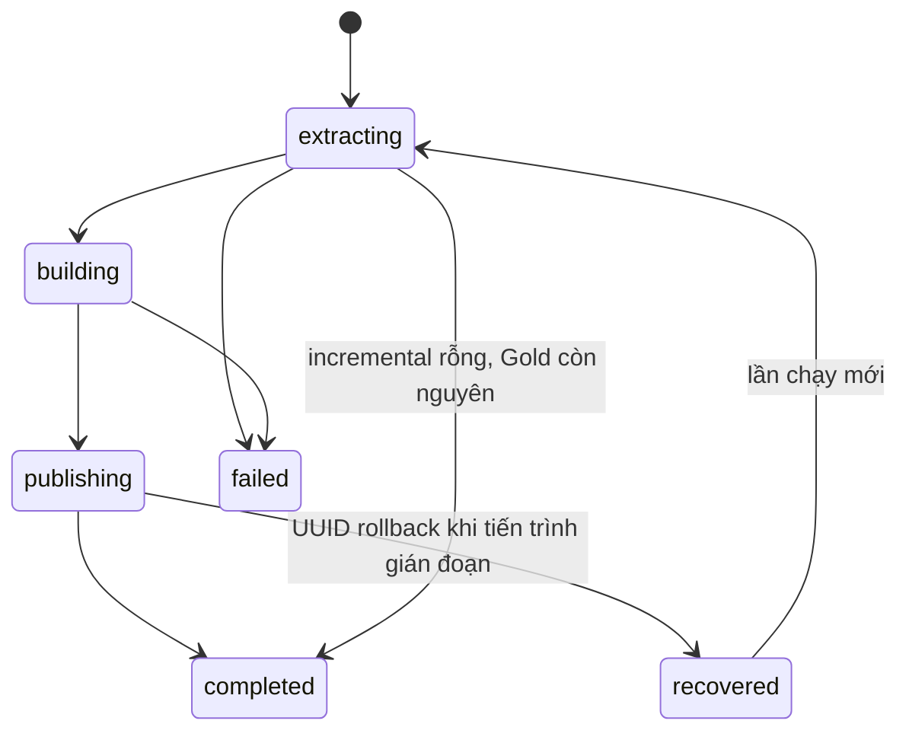

# Kiến trúc hiện hành · v3

## Ranh giới dữ liệu

| Thành phần | Nơi lưu | Vai trò |
|---|---|---|
| OLTP, lịch sử người dùng, change journal | PostgreSQL `learning_oltp.oltp` | Nguồn tác nghiệp, trigger ghi revision và nhật ký cùng transaction |
| Silver | PostgreSQL `dwh_staging.silver` | Bản sạch, PK theo khóa nguồn, upsert |
| Quarantine | PostgreSQL `dwh_staging.quarantine` | Payload lỗi, mã lỗi, thời điểm và trạng thái đã sửa |
| Control state | PostgreSQL `dwh_staging.staging` | Checkpoint, revision, delta chờ, manifest, kế hoạch công bố |
| Gold ứng viên | ClickHouse `gold_build` | Dựng, kiểm tra, đối soát trước khi phục vụ |
| Gold phục vụ | ClickHouse `gold` | 4 fact, 7 dimension, 2 bảng tổng hợp và 2 materialized-view feed |
| Bridge tạm | ClickHouse `stage_bridge` | PostgreSQL table engine đọc Silver, xóa sau khi dùng |
| Benchmark mirror | PostgreSQL `dwh_staging.benchmark` | Bản sao nguyên Gold để kiểm tra equality và đo truy vấn |

Không lưu bản sao Bronze riêng trong ClickHouse. Dữ liệu gốc nằm ở OLTP và payload journal. ETL không ghi vào OLTP. `setup`, generator và script demo sử dụng tài khoản quản trị nguồn, tách với reader của ETL.

## Grain và bus matrix

| Fact | Grain | Date roles | User | Course | Instructor | Lesson | Quiz | Method |
|---|---|---|---|---|---|---|---|---|
| fact_enrollments | Một enrollment_id, accumulating snapshot | enrolled, completed | ✓ | ✓ | ✓ | | | |
| fact_payments | Một payment_id, transaction_id duy nhất | paid | ✓ | ✓ | ✓ | | | ✓ |
| fact_lesson_completions | Một completion_id, enrollment + lesson duy nhất | completed | ✓ | ✓ | | ✓ | | |
| fact_quiz_attempts | Một attempt_id, enrollment + quiz + attempt_number duy nhất | attempted | ✓ | ✓ | | | ✓ | |

Có 7 dimension. `dim_date` conformed và role playing, `dim_user` SCD Type 2, các chiều còn lại Type 1. Khóa sự kiện và transaction_id là degenerate references. Không join trực tiếp hai fact ở mức chi tiết để tính tổng. Báo cáo drill across gộp từng fact về cùng grain trước khi join.

`lessons_completed` là trạng thái tại snapshot hiện tại. Bộ dữ liệu không có daily snapshot, không thể suy ra đầy đủ tiến độ tại từng ngày trong quá khứ. Thời điểm sự kiện dùng UTC, kỳ cố định 2022–2024. Tiền dùng số nguyên VND, không có số thực tiền tệ.

## Full và incremental

Full đọc một snapshot `REPEATABLE READ`, theo lô 50.000 dòng. Silver và revision state được ghi trong một transaction. Cờ `stage_state.needs_full` buộc dựng đầy đủ nếu full stage đã commit nhưng Gold chưa công bố. Lần chạy tiếp theo không được bỏ qua snapshot đang chờ đó.

Incremental đọc `oltp.change_journal`. Trigger gắn `source_xid`, `revision`, thao tác và payload. ETL chỉ nhận giao dịch có XID trong `[checkpoint, snapshot xmin)`. Mọi XID nhỏ hơn xmin đã kết thúc. Một giao dịch mở lâu có thể làm trì hoãn cả các giao dịch mới hơn đã commit, đổi lại không bỏ sót commit lệch thứ tự. ETL kết hợp revision mỗi khóa để bỏ qua bản cũ hoặc bản đã áp dụng từ full snapshot.

Trạng thái `source_versions` chặn replay cũ. `pending_changes` giữ các khóa đã ghi Silver nhưng chưa được công bố. Cập nhật và xóa vẫn được áp dụng sau khi pipeline thất bại rồi chạy lại, kể cả lần đọc journal tiếp theo không có phiên bản mới. Một cập nhật lỗi được cách ly và giữ bản sạch trước đó; nguồn sửa hợp lệ sẽ cập nhật Silver và đánh dấu lỗi cũ đã giải quyết.

Các dimension được dựng lại. Khi có thay đổi lịch sử hoặc master liên quan, facts được dựng lại để ánh xạ lại khóa. Fact sự kiện mới chỉ chèn delta và giữ partition cũ. Sửa một sự kiện cũ hoặc xóa vật lý sẽ dựng lại fact đó. Enrollment được thay phiên bản và gộp partition ảnh hưởng; đổi tháng ghi danh thì dựng lại. Lần rỗng kiểm tra UUID và số dòng Gold trước khi tái sử dụng. Không hỗ trợ sửa Gold thủ công ngoài pipeline.

## SCD2

Nguồn duy trì `user_history`, mỗi phiên bản có `[valid_from, valid_to)`, sentinel 2100-01-01. Gold dùng `ASOF JOIN` theo user_id và thời điểm sự kiện rồi kiểm tra sự kiện nằm trước valid_to. `user_sk = history_id + 10000000`. Có đúng một phiên bản current, không chồng lấn hoặc đứt khoảng và không trùng thời điểm bắt đầu.

Địa lý trong thanh toán là địa lý tại ngày thanh toán. Enrollment dùng phiên bản tại ngày ghi danh, kể cả hoàn thành sau khi học viên chuyển vùng. Đếm người duy nhất qua nhiều fact phải dùng natural user_id thông qua dimension, không đếm user_sk.

## Công bố và phục hồi

Trước đổi bảng đầu tiên, ETL lưu UUID bảng cũ, UUID ứng viên và phase `publishing` trong PostgreSQL. Feed materialized view được gỡ trước khi đổi bảng và tạo lại sau đó. Nếu bị dừng, lần chạy kế tiếp so UUID thực tế và đảo các bảng đã đổi về bản trước. Không dựa vào một danh sách chỉ nằm trong RAM. Nếu UUID không khớp kế hoạch, hệ thống dừng và giữ nguyên `gold_build` để điều tra.

Sau khi đổi đủ bảng và tạo feed, ETL commit manifest thành công, checkpoint và xóa pending changes trong cùng transaction PostgreSQL. Sau đó mới xóa Gold cũ. JSON là bản xuất hỗ trợ đọc và bàn giao; `published_state` là trạng thái có thẩm quyền.

`EXCHANGE TABLES` chỉ nguyên tử ở từng bảng. CLI và portal dùng PostgreSQL advisory lock chung, writer độc quyền, reader chia sẻ. Dashboard lấy một snapshot gồm toàn bộ dữ liệu biểu đồ trong cùng khóa đọc. Reports có khóa đọc, benchmark và validate có khóa độc quyền do sử dụng schema tạm. Consumer SQL bên ngoài phải tránh cửa sổ công bố hoặc dùng cùng khóa trong database staging. Khóa chỉ có tác dụng khi còn giữ connection.

## Quyền và tài nguyên

`learning_reader` chỉ SELECT nguồn, giao dịch mặc định read only. `learning_stage` ghi Silver/control/quarantine/benchmark và không CONNECT OLTP. Dashboard không nhận mật khẩu quản trị PostgreSQL. Tài khoản ClickHouse hiện dùng chung cho pipeline và dashboard trong phạm vi localhost.

PostgreSQL giới hạn 2 GiB/4 CPU, ClickHouse 3 GiB/4 CPU, runner 1500 MiB/4 CPU, dashboard 1500 MiB/2 CPU. ClickHouse query giới hạn 1,8 GB, spill sort/group by ở 500 MB và 4 thread. Nguồn và Gold dùng volume riêng; Docker image không chứa artifacts, .env hoặc dữ liệu runtime.

## Giới hạn thiết kế

Journal do trigger quản lý trong cùng PostgreSQL, chưa có WAL connector, retention, backpressure hoặc lịch chạy tự động. Không tắt trigger, không TRUNCATE nguồn để mô phỏng delete; các thao tác đó cần full reload. `dw.bulk_seed` chỉ dùng trong generator trên nguồn trống. Không bật tùy chọn đó cho thay đổi thường ngày.

Đổi schema nguồn cần sửa contract và mapping, rồi chạy full. Lịch ngoài 2022–2024 cần mở rộng dimension ngày và quality gate. Trường sự kiện Gold hiện lưu độ chính xác giây; không dùng cho nguồn cần bảo toàn phần nhỏ giây. Chưa có authentication portal, backup tự động hoặc nghiệm thu tải production. Các giới hạn này được giữ rõ trong bàn giao.
